<div align="center">

# IMS — Inventory Management System

**Try it: [ims-three-theta.vercel.app](https://ims-three-theta.vercel.app)**

| Role | Email | Password |
|------|-------|----------|
| Admin | `fahad@alnoor-supplies.sa` | `demo1234` |
| Admin | `noura@alnoor-supplies.sa` | `demo1234` |

<sub>The backend runs on a free server that sleeps when idle, so the first sign-in can take up to a minute.</sub>

A full-stack web app for small shops and warehouses to manage products, stock and sales invoices in one place.<br>
It comes with an analytics dashboard, Excel exports, printable invoices and an AI assistant that answers questions about your own data.


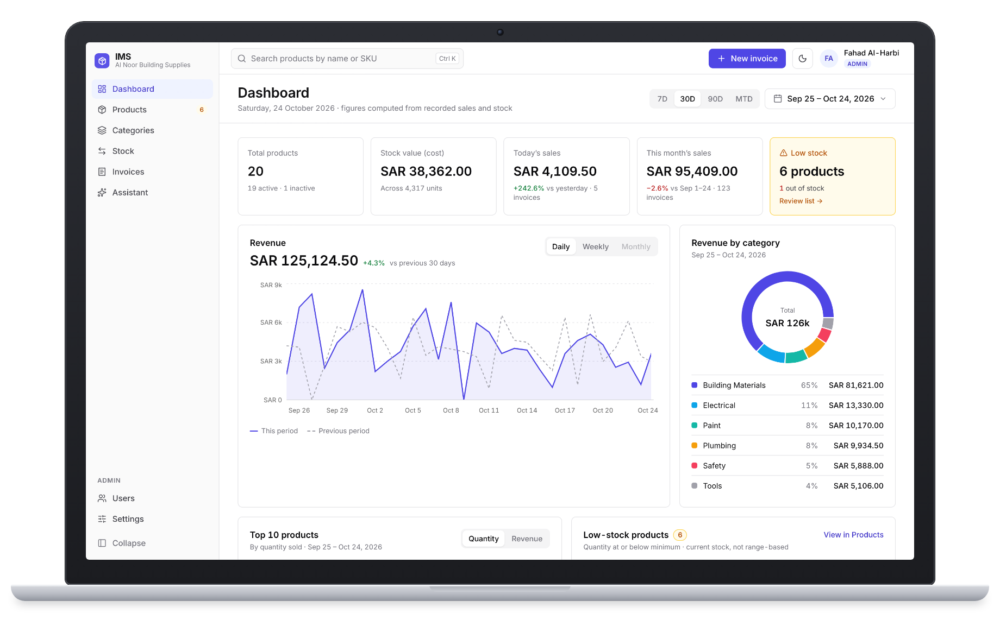

</div>

---

## Tech stack

| Layer | Technologies |
|-------|--------------|
| **Frontend** | React 19, TypeScript, Vite, Tailwind CSS v4, shadcn/ui (Radix), TanStack Query, React Router, React Hook Form + Zod, Recharts |
| **Backend** | Python 3.13, FastAPI, SQLAlchemy 2, Alembic, Pydantic |
| **Database & Auth** | Supabase (PostgreSQL + Supabase Auth, JWT) |
| **AI** | Google Gemini via the `google-genai` SDK, with tool calling |
| **Documents** | openpyxl (Excel exports), WeasyPrint (invoice PDFs) |
| **Testing** | pytest, Vitest + React Testing Library |
| **DevOps** | Docker, docker-compose, GitHub Actions CI |

---

## Features

### 📊 Analytics dashboard
Live KPIs (stock value, today's and this month's sales, low-stock count), a revenue chart compared with the previous period, revenue by category, top-selling products and a low-stock list. One date range (7D, 30D, 90D, month-to-date or custom) drives every widget, and all figures are calculated in SQL on the backend.

### 📦 Products & categories
Search, filter, sort and paginate the catalog. Products show their stock level at a glance, with low-stock and inactive badges. Categories support one level of subcategories.

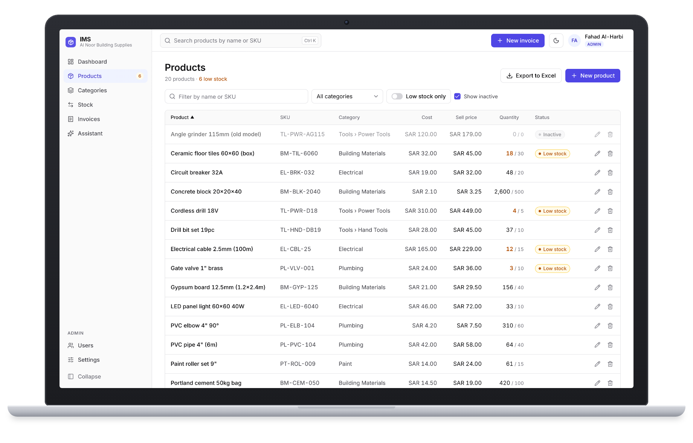

Each product has its own page with its stock history, a 30-day stock-level chart and recent sales.

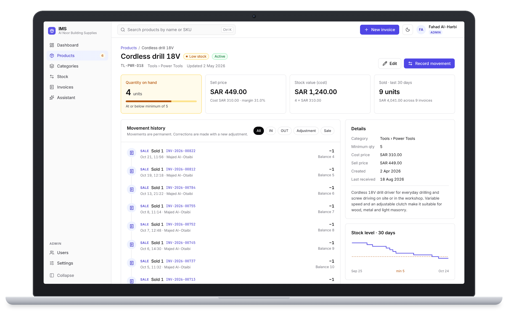

### 🔄 Stock movements
Stock never changes silently: every change is recorded as a movement (**IN**, **OUT**, **ADJUSTMENT** or **SALE**) with the user, a note and the balance after it. The history can be filtered by type and date range and exported to Excel.

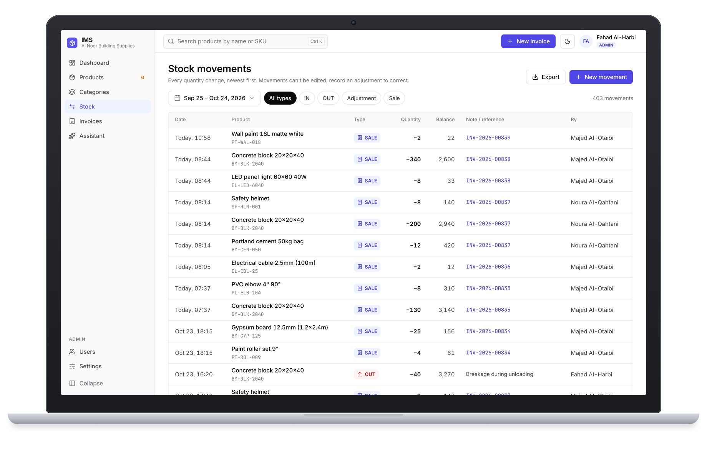

### 🧾 Invoices
Build an invoice by searching or tapping products. Saving it reduces stock in the same database transaction, and invoice numbers are sequential per year (`INV-2026-00001`). Invoices can be printed, downloaded as a PDF or exported to Excel. Admins can cancel an invoice, which restores its stock automatically.

<table>
  <tr>
    <td width="50%">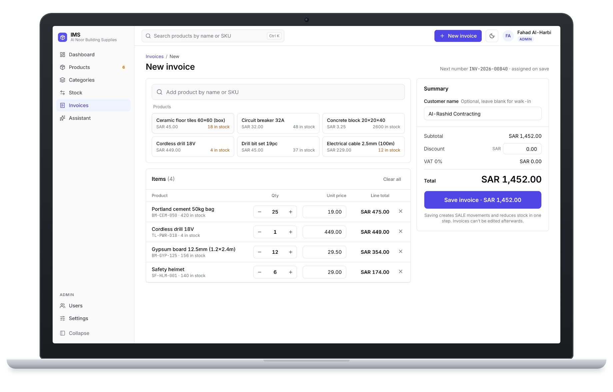</td>
    <td width="50%">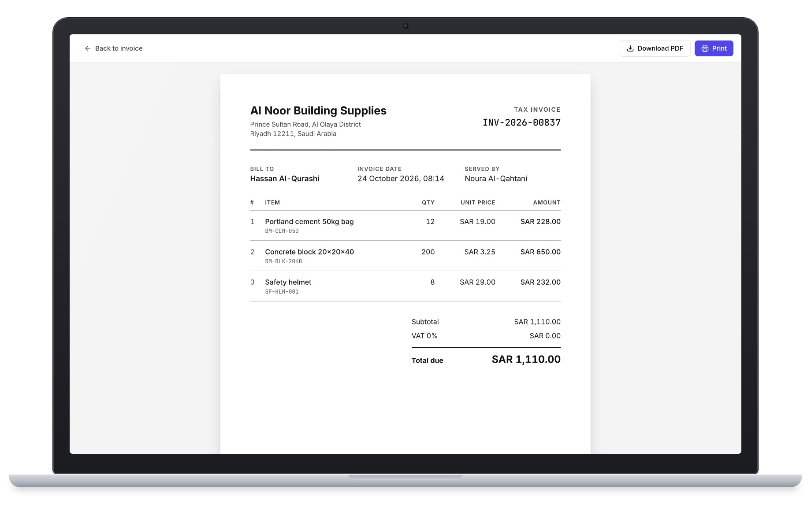</td>
  </tr>
  <tr>
    <td align="center"><sub>Creating an invoice</sub></td>
    <td align="center"><sub>Printable invoice / PDF</sub></td>
  </tr>
</table>

### 🤖 AI assistant
Ask questions in plain language ("What's running low?", "Best-selling tools in September") and generate a written insights report for any period. The model never sees the database directly: it calls five **read-only** backend tools, every figure is computed by IMS, and each answer shows which data it used. Each user has an hourly request limit. The assistant can also draft product descriptions.

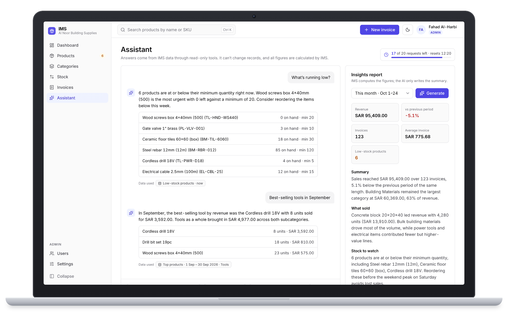

### 👥 Users & roles
Two roles, enforced on the backend (not just hidden in the UI):

| | Admin | Staff |
|---|:---:|:---:|
| View products, record stock, create & print invoices, dashboard | ✅ | ✅ |
| Change prices, delete records, cancel invoices | ✅ | ❌ |
| Manage users and business settings | ✅ | ❌ |

Users are deactivated rather than deleted, so their invoices and movements stay attributed.

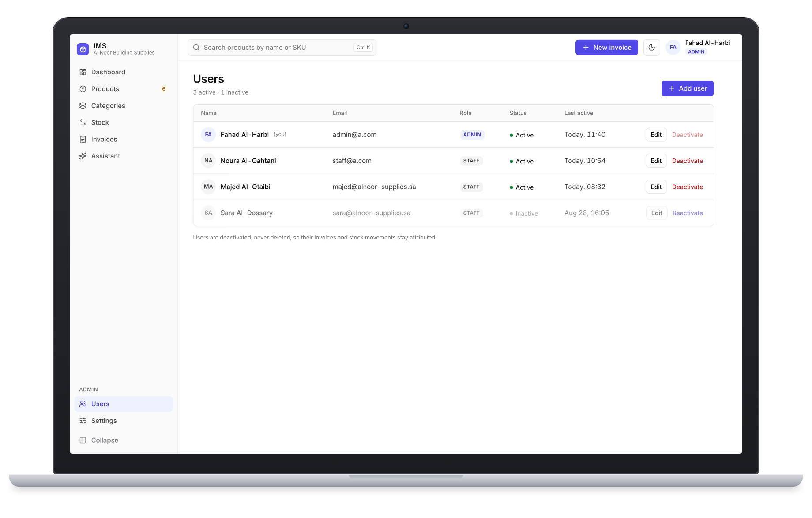

### 🌙 Dark mode
A full dark theme, remembered per browser.

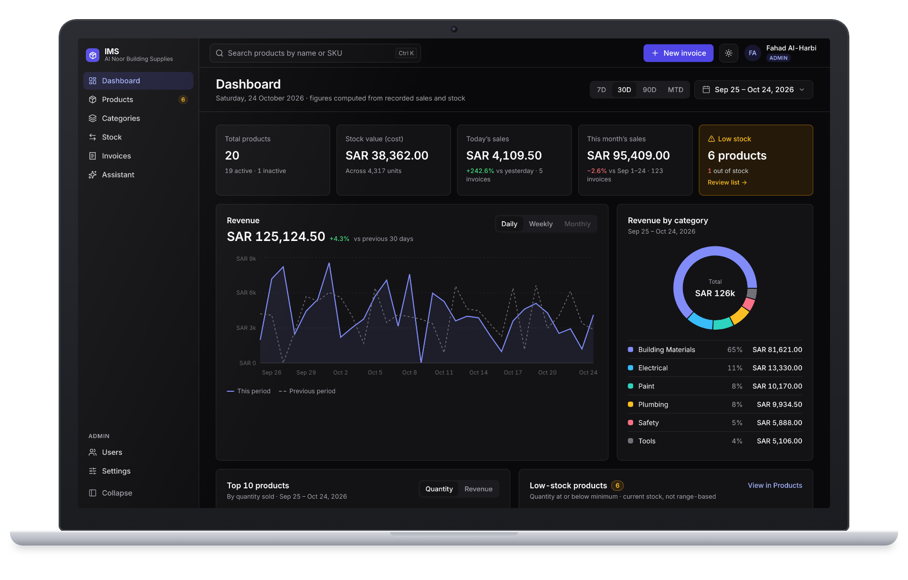

<details>
<summary><b>More screenshots</b></summary>
<br>

| Sign in | Invoices |
|---|---|
| 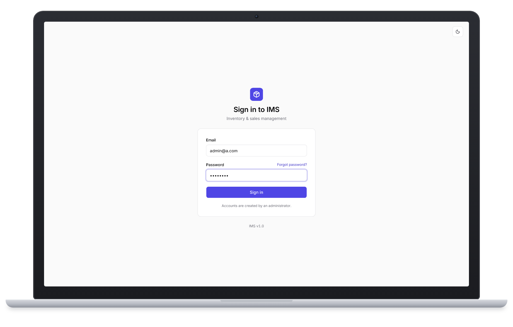 | 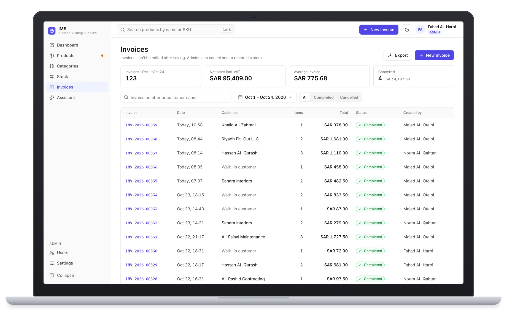 |
| **Invoice details** | **Categories** |
| 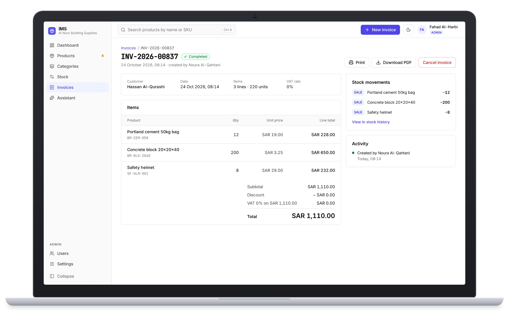 | 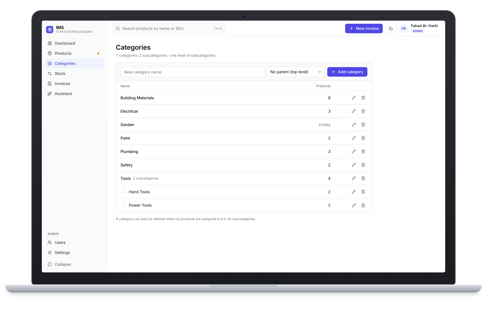 |
| **Business settings** | |
| 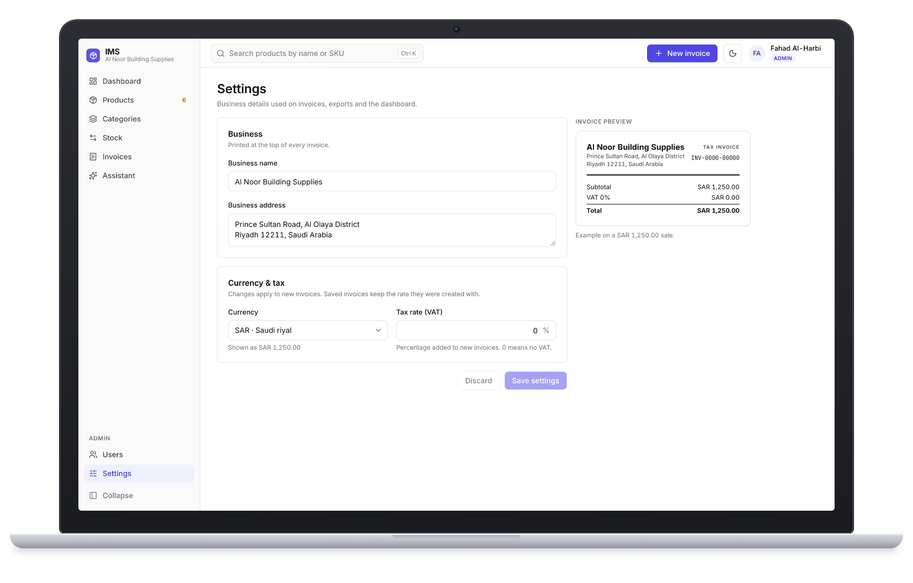 | |

</details>

---

## Run it on your computer

### 1. Install the prerequisites

| Tool | Why | Get it |
|------|-----|--------|
| **Git** | Download the code | https://git-scm.com/downloads |
| **Docker Desktop** | Runs the local database and auth (Supabase) | https://www.docker.com/products/docker-desktop |
| **Node.js 24** | Runs the frontend (and the Supabase CLI via `npx`) | https://nodejs.org |
| **uv** | Installs Python and the backend packages | https://docs.astral.sh/uv/getting-started/installation |

You don't need to install Python yourself: `uv` downloads the right version (3.13) automatically.
Make sure **Docker Desktop is open and running** before step 3.

### 2. Get the code

```bash
git clone https://github.com/Nawaf1054/IMS.git
cd IMS
```

### 3. Start the database and auth (Supabase)

```bash
npx supabase start
```

The first run downloads the Docker images and takes a few minutes. When it finishes it prints the local URLs and keys. You can print them again any time with `npx supabase status`.

### 4. Create your `.env` file

Copy the example file:

```bash
# macOS / Linux / Git Bash
cp .env.example .env

# Windows PowerShell
Copy-Item .env.example .env
```

Open `.env` and fill in these values from the `npx supabase status` output:

| Variable | Value from `supabase status` |
|----------|------------------------------|
| `SUPABASE_SECRET_KEY` | **Secret key** (or `service_role key` on older CLI versions) |
| `SUPABASE_JWT_SECRET` | **JWT secret** |
| `VITE_SUPABASE_PUBLISHABLE_KEY` | **Publishable key** (or `anon key` on older CLI versions) |
| `SEED_ADMIN_PASSWORD` | Any password you like, for your first admin account |

Everything else already points at the local stack.

### 5. Start the backend

Open a terminal in the project folder:

```bash
cd backend
uv sync                                  # install Python + packages
uv run alembic upgrade head              # create the database tables
uv run python -m scripts.seed --demo     # create the admin + demo users, products and stock
uv run uvicorn app.main:app --reload     # start the API
```

The API runs at http://localhost:8000 and its interactive docs at http://localhost:8000/api/docs. Keep this terminal open.

### 6. Start the frontend

Open a **second** terminal in the project folder:

```bash
cd frontend
npm install
npm run dev
```

### 7. Sign in

Open **http://localhost:5173** and sign in with `SEED_ADMIN_EMAIL` / `SEED_ADMIN_PASSWORD` from your `.env`. The `--demo` seed also creates these accounts (password `demo1234`):

| Role | Email |
|------|-------|
| Admin | `admin@a.com` |
| Staff | `staff@a.com`, `majed@alnoor-supplies.sa` |

> The demo seed adds a catalog with opening stock but no invoices, so the dashboard's sales figures start at zero. Create a few invoices to see the charts come alive.

### Optional: turn on the AI assistant

1. Create a free API key in [Google AI Studio](https://aistudio.google.com/apikey).
2. Add it to `.env` (server side only, never in a `VITE_` variable):
   ```bash
   LLM_API_KEY=your-gemini-api-key
   ```
3. Restart the backend.

Without a key, everything else works normally; only the assistant's requests are refused.

### Next time you run it

```bash
npx supabase start                                   # if it isn't already running
cd backend  && uv run uvicorn app.main:app --reload  # terminal 1
cd frontend && npm run dev                           # terminal 2
```

Stop the database with `npx supabase stop`. Browse the database at http://127.0.0.1:54323 (Supabase Studio).

<details>
<summary><b>Run the backend and frontend in Docker instead</b></summary>
<br>

Supabase still runs through `npx supabase start`. Then:

```bash
docker compose up --build
docker compose run --rm backend alembic upgrade head
docker compose run --rm backend python -m scripts.seed --demo
```

When using the **local** Supabase stack, uncomment the `environment:` block for the `backend` service in `docker-compose.yml` so the container can reach the database on your machine.

</details>

<details>
<summary><b>Troubleshooting</b></summary>
<br>

- **`npx supabase start` fails:** make sure Docker Desktop is running, then try again.
- **"Download PDF" says PDFs are unavailable (Windows):** PDF generation needs the Pango library, which Windows doesn't include. Printing from the browser still works, and the Docker backend includes Pango.
- **Can't sign in:** check that the three Supabase values in `.env` match `npx supabase status`, then restart both the backend and the frontend.
- **Port already in use:** another program is using one of the ports (8000, 5173 or Supabase's 54321–54324). Stop it and try again.

</details>

---

## Project structure

```
IMS/
├── backend/     FastAPI service: one module per feature under app/modules, Alembic migrations, seed scripts
├── frontend/    React app: one folder per feature under src/features
├── supabase/    Supabase CLI config for the local database and auth
├── docs/        Product requirements (PRD) and architecture notes
└── .github/     CI: lint, type check, tests and build on every push
```

See [docs/architecture.md](docs/architecture.md) for conventions and [docs/PRD.md](docs/PRD.md) for the full requirements.

## Tests and code quality

| Frontend (`frontend/`) | Backend (`backend/`) |
|---|---|
| `npm run test` — unit tests (Vitest) | `uv run pytest --cov` — tests (needs the database running) |
| `npm run lint` — ESLint | `uv run ruff check .` — lint |
| `npm run typecheck` — TypeScript | `uv run mypy app scripts` — type check |
| `npm run build` — production build | `uv run ruff format .` — format |
